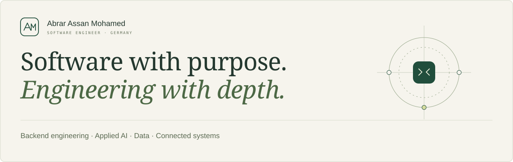

  
    
  <a href="https://abrar0205.github.io/abrar0205/"><strong>Explore my portfolio →</strong></a>
  &nbsp; · &nbsp;
  <a href="https://linkedin.com/in/abrar-a-m">LinkedIn</a>
  &nbsp; · &nbsp;
  <a href="mailto:abraram.cnr@gmail.com">Email</a>

 

I’m **Abrar Assan Mohamed**, a software engineer working across **backend services, applied AI, data, and connected systems**.

At **Siemens Energy**, I contribute to AI and backend workflows as a working student. Previously, I worked on connected-vehicle software at **Tata Elxsi**. I enjoy taking a problem from its data and service contracts through to a usable, testable application.

**Open to full-time opportunities in Germany for 2027** — software and backend engineering, applied AI, data, and automotive roles.

### Selected projects

| Project | What you can explore | Links |
| :--- | :--- | :--- |
| **IgnitionTrace** | An automotive engineering workbench: replay traces, inspect evidence, compare runs, and capture measurements with an Android app recorder. | [Source & local setup](https://github.com/abrar0205/ignition-trace) |
| **EnterpriseIQ** | A document question-answering API with vector + keyword retrieval, role-based filtering, citations, and an offline extractive mode. | [Source & architecture](https://github.com/EnterpriseIQ/enterprise-knowledge-intelligence-platform) |
| **ModalityOps** | A local-first workbench for signal quality, recording gaps, and shared-event clock estimation across EEG, audio, and video. | [Live demo](https://abrar0205.github.io/modalityops/) · [Source](https://github.com/abrar0205/modalityops) |

IgnitionTrace’s generated scenarios use synthetic traces; its Android recorder measures its own app and permitted vehicle properties. ModalityOps’ hosted demo uses precomputed reports from synthetic signals; fresh analyses run locally.

### The project notebook

- **[Energy Market Intelligence](https://github.com/abrar0205/energymarket)** — FastAPI + React, simulated market feeds, and REST/WebSocket delivery.
- **[Audio–Video Signal Toolkit](https://github.com/abrar0205/multimodal-audio-video-signal-analysis)** — reusable Python API and CLI for acoustic features, video QC, and missing-data-aware analysis.
- **[Clinical NLP Benchmark](https://github.com/abrar0205/clinical-nlp-labeling-benchmark)** — keyword, negation-rule, and local-LLM baselines evaluated on synthetic text snippets.
- **[Federated Learning Lab](https://github.com/abrar0205/federated-learning-feature-heterogeneity)** — a PyTorch learning project comparing FedAvg and FedBN under simulated client feature shifts.
- **[Sensor Fusion for Movement](https://github.com/abrar0205/lower-limb-prosthetic-control-ml)** — synthetic EMG/IMU classification with single-sensor and fused baselines.
- **[MRI Simulation Lab](https://github.com/abrar0205/MRI)** — Python signal modelling, k-space sampling, and reconstruction with synthetic phantoms.

### Toolkit

**Backend & data** · Python · FastAPI · REST APIs · SQL · Kafka · RabbitMQ

**Applied AI & ML** · RAG · CrewAI · ChromaDB · PyTorch · scikit-learn · NumPy

**Connected systems** · AWS IoT Core · MQTT · Telemetry · Trace analysis · Signal processing

**Delivery & interfaces** · Docker · GitHub Actions · pytest · React · TypeScript

These tools come from professional experience and independent projects. The [portfolio](https://abrar0205.github.io/abrar0205/) explains the context and implementation behind the work.

### Background

M.Sc. Medical Engineering, **FAU Erlangen–Nürnberg** — in progress, with a focus on Medical Image and Data Processing.

Professional experience is summarized at a high level. Employer code, internal materials, and private datasets are not published here.

---

[**Let’s connect**](mailto:abraram.cnr@gmail.com) · [Request my CV](mailto:abraram.cnr@gmail.com?subject=CV%20request%20%E2%80%94%20Abrar%20Assan%20Mohamed)

About this repository

This repository contains my GitHub profile README and portfolio website, built with React, TypeScript, Vite, and Tailwind CSS.

See [development and deployment notes](./docs/DEVELOPMENT.md) for local setup, content editing, and GitHub Pages publishing.

